# Temper ZMK Config

This is my personal ZMK config for the [temper](https://github.com/raeedcho/temper).

Some notes about this config:
- Four main layers (default, numbers/symbols, navigation, and function)
- Default layer is a Colemak DH alpha layer
- Navigation layer has vim-like arrow keys, and includes mouse emulation, specifically cursor movement and a left and right click. It also has basic media controls
- The function layer includes connection controls (USB v Bluetooth, as well as Bluetooth profile selection) on the left hand side, and function keys on the right hand side

